<!-- Archit Anshuman | original visual system: cobalt, teal, amber; built from resume facts. -->

  <picture>
    <source media="(prefers-color-scheme: dark)" srcset="./assets/banner-dark.svg" />
    <source media="(prefers-color-scheme: light)" srcset="./assets/banner-light.svg" />
    
  </picture>

  <picture>
    <source media="(prefers-color-scheme: dark)" srcset="./assets/profile-tagline-dark.svg" />
    <source media="(prefers-color-scheme: light)" srcset="./assets/profile-tagline-light.svg" />
    
  </picture>

  
  &nbsp;
  
  &nbsp;
  

B.E. CSE · Dr. Ambedkar Institute of Technology, Bengaluru · CGPA 8.14/10 · 2023–2027

  
  
  

---

<picture><source media="(prefers-color-scheme: dark)" srcset="./assets/sections/section-01-about-dark.svg"/><source media="(prefers-color-scheme: light)" srcset="./assets/sections/section-01-about-light.svg"/></picture>

I'm **Archit Anshuman**, a Computer Science and Engineering undergraduate at **Dr. Ambedkar Institute of Technology, Bengaluru**. I build applied AI systems, agentic workflows and NLP-driven automation that translate complex information into useful, explainable outcomes.

My work spans **LLM orchestration, retrieval-augmented generation, semantic search, model-driven risk signals and backend APIs**. I care about reliable execution, observability, privacy-aware data handling and engineering decisions that can be explained.

<strong>AI Engineering Intern · Agentic Systems · NLP / RAG · Applied ML</strong>

<picture><source media="(prefers-color-scheme: dark)" srcset="./assets/sections/section-02-signals-dark.svg"/><source media="(prefers-color-scheme: light)" srcset="./assets/sections/section-02-signals-light.svg"/></picture>

LIVE FROM THE PROFILE CONTRIBUTION CALENDAR · UPDATED BY GITHUB ACTIONS

<picture><source media="(prefers-color-scheme: dark)" srcset="./assets/animated/activity-graph-dark.svg"/><source media="(prefers-color-scheme: light)" srcset="./assets/animated/activity-graph-light.svg"/></picture>

<picture><source media="(prefers-color-scheme: dark)" srcset="./contrib-heatmap.svg"/><source media="(prefers-color-scheme: light)" srcset="./contrib-heatmap-light.svg"/></picture>

<picture><source media="(prefers-color-scheme: dark)" srcset="./profile-ascii.svg"/><source media="(prefers-color-scheme: light)" srcset="./profile-ascii-light.svg"/></picture> <picture><source media="(prefers-color-scheme: dark)" srcset="./stats.svg"/><source media="(prefers-color-scheme: light)" srcset="./stats-light.svg"/></picture>

<picture><source media="(prefers-color-scheme: dark)" srcset="./assets/sections/section-03-leadership-building-dark.svg"/><source media="(prefers-color-scheme: light)" srcset="./assets/sections/section-03-leadership-building-light.svg"/></picture>

<picture><source media="(prefers-color-scheme: dark)" srcset="./assets/animated/leadership-ai-build-challenge-dark.svg"/><source media="(prefers-color-scheme: light)" srcset="./assets/animated/leadership-ai-build-challenge-light.svg"/></picture>

### Core Team Member · Tech Club, Dr. AIT

- Led coding sprints and peer-mentoring sessions in **Artificial Intelligence and Full-Stack Development**.
- Led development of a centralized club portal for event registration and resource sharing used by **500+ students**.
- At the **AI Build Challenge — Bengaluru 2026**, served as team lead and earned **1st Runner-Up** in the AI product-building sprint organized by Hackingly and Masters' Union Ventures, with Qualcomm as industry partner.

<picture><source media="(prefers-color-scheme: dark)" srcset="./assets/sections/section-04-technical-skills-dark.svg"/><source media="(prefers-color-scheme: light)" srcset="./assets/sections/section-04-technical-skills-light.svg"/></picture>

LANGUAGES · AGENT FRAMEWORKS · APPLIED AI · BACKEND · RETRIEVAL

<picture><source media="(prefers-color-scheme: dark)" srcset="./assets/animated/skills-grid-dark.svg"/><source media="(prefers-color-scheme: light)" srcset="./assets/animated/skills-grid-light.svg"/></picture>

<picture><source media="(prefers-color-scheme: dark)" srcset="./assets/sections/section-05-featured-projects-dark.svg"/><source media="(prefers-color-scheme: light)" srcset="./assets/sections/section-05-featured-projects-light.svg"/></picture>

<picture><source media="(prefers-color-scheme: dark)" srcset="./assets/animated/project-urjanetra-dark.svg"/><source media="(prefers-color-scheme: light)" srcset="./assets/animated/project-urjanetra-light.svg"/></picture>

### UrjaNetra AI — Energy Supply Chain Decision Support System

An AI-assisted early-warning and decision-support concept that combines signals across **weather, shipping, commodity prices, energy demand and geopolitical events**.

- Built an end-to-end prediction pipeline with **Python, FastAPI, React, LangGraph, LSTM, Transformers and XGBoost**.
- Combined predictive signals into supply-chain risk assessments, forecasts and explainable decision support.

<picture><source media="(prefers-color-scheme: dark)" srcset="./assets/animated/project-ayuscout-dark.svg"/><source media="(prefers-color-scheme: light)" srcset="./assets/animated/project-ayuscout-light.svg"/></picture>

### AyuScout AI — Real-Time Patient Safety Signal Detection Platform

An AI-driven pharmacovigilance platform designed to process **10,000+ patient discussions daily**, detect adverse drug reactions and surface emerging safety signals.

- Combined **LangGraph, Ollama and ChromaDB** with semantic retrieval, PII masking and severity classification.
- Resume-reported estimates: **70% less manual monitoring effort** and **35–40% improvement in risk-detection accuracy** through multi-stage signal processing.

<picture><source media="(prefers-color-scheme: dark)" srcset="./assets/sections/section-06-achievements-dark.svg"/><source media="(prefers-color-scheme: light)" srcset="./assets/sections/section-06-achievements-light.svg"/></picture>

<table width="100%">
  <tr>
    <td width="50%" valign="top"><picture><source media="(prefers-color-scheme: dark)" srcset="./assets/animated/achievement-ai-for-bharat-dark.svg"/><source media="(prefers-color-scheme: light)" srcset="./assets/animated/achievement-ai-for-bharat-light.svg"/></picture></td>
    <td width="50%" valign="top"><picture><source media="(prefers-color-scheme: dark)" srcset="./assets/animated/achievement-ai-build-challenge-dark.svg"/><source media="(prefers-color-scheme: light)" srcset="./assets/animated/achievement-ai-build-challenge-light.svg"/></picture></td>
  </tr>
</table>

- **Winner** — AI for Bharat Hackathon (HackerEarth and Government of Karnataka).
- **Finalist** — Global Academy National Level Hackathon.
- **Rank 418** — HackerRank Orchestrate.
- **5-Star MySQL Badge** — HackerRank.
- Participant — Bangalore Tech Summit Developer Challenge, KJU Hackathon and Hack-A-League 4.0.

<picture><source media="(prefers-color-scheme: dark)" srcset="./assets/sections/section-07-education-experience-dark.svg"/><source media="(prefers-color-scheme: light)" srcset="./assets/sections/section-07-education-experience-light.svg"/></picture>

| Education / Experience | Details |
|---|---|
| **B.E. Computer Science & Engineering** | Dr. Ambedkar Institute of Technology, Bengaluru · 2023–2027 · **CGPA 8.14/10** |
| **AI Engineering Intern** | Tensor And Maxwell Corporation · Sep 2025 – Feb 2026 |
| **Class XII — Science** | The Aditya Birla Public School · 79.6% · 2023 |
| **Class X** | The Aditya Birla Public School · 84% · 2021 |

During the internship, I designed multi-step AI workflows using **LangGraph, CrewAI, AutoGen, n8n and OpenAI Agents SDK**; built NLP-driven automation pipelines; and implemented **Agent Performance Monitoring (APM)** and **Agent Process Control (APC)** to improve reliability, observability and execution efficiency.

<picture><source media="(prefers-color-scheme: dark)" srcset="./assets/sections/section-08-contributions-dark.svg"/><source media="(prefers-color-scheme: light)" srcset="./assets/sections/section-08-contributions-light.svg"/></picture>

<picture><source media="(prefers-color-scheme: dark)" srcset="https://raw.githubusercontent.com/anshumanarchit-crypto/anshumanarchit-crypto/output/github-snake-dark.svg"/><source media="(prefers-color-scheme: light)" srcset="https://raw.githubusercontent.com/anshumanarchit-crypto/anshumanarchit-crypto/output/github-snake.svg"/></picture>

<picture><source media="(prefers-color-scheme: dark)" srcset="./assets/sections/section-09-connect-dark.svg"/><source media="(prefers-color-scheme: light)" srcset="./assets/sections/section-09-connect-light.svg"/></picture>

  
  
  

Build thoughtfully. Automate responsibly. Make complex systems useful.

