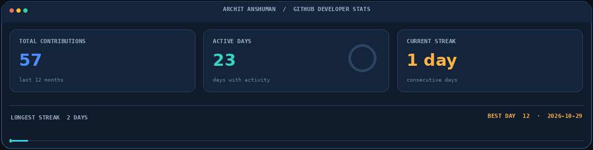
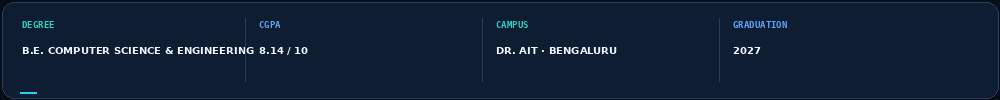
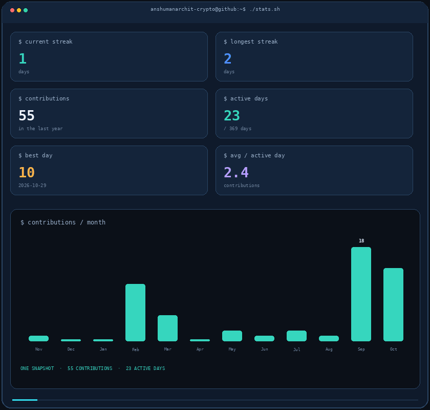
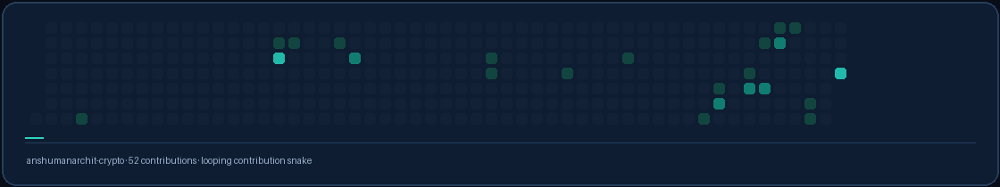

<!-- Archit Anshuman | reference-layout rollback; keeps the custom animated banner and real-photo ASCII portrait. -->

  <picture>
    <source media="(prefers-color-scheme: dark)" srcset="./banner-dark.gif" />
    <source media="(prefers-color-scheme: light)" srcset="./banner-light.gif" />
    
  </picture>

  <picture>
    <source media="(prefers-color-scheme: dark)" srcset="./assets/animated/profile-tagline-dark.gif" />
    <source media="(prefers-color-scheme: light)" srcset="./assets/animated/profile-tagline-light.gif" />
    
  </picture>

  <a href="https://www.linkedin.com/in/archit-anshuman-921249324/"> LinkedIn</a>
  &nbsp;&nbsp;·&nbsp;&nbsp;
  <a href="https://www.hackerrank.com/profile/anshumanarchit"> HackerRank</a>
  &nbsp;&nbsp;·&nbsp;&nbsp;
  <a href="mailto:architanshuman5@gmail.com"> Email</a>

---

<picture><source media="(prefers-color-scheme: dark)" srcset="./assets/section-developer-stats-accent.svg" /><source media="(prefers-color-scheme: light)" srcset="./assets/section-developer-stats-accent-light.svg" /></picture>

<picture><source media="(prefers-color-scheme: dark)" srcset="./assets/animated/developer-overview-dark.gif" /><source media="(prefers-color-scheme: light)" srcset="./assets/animated/developer-overview-light.gif" /></picture>

<picture><source media="(prefers-color-scheme: dark)" srcset="./assets/section-about-accent.svg" /><source media="(prefers-color-scheme: light)" srcset="./assets/section-about-accent-light.svg" /></picture>

I'm **Archit Anshuman**, a Computer Science and Engineering undergraduate at **Dr. Ambedkar Institute of Technology, Bengaluru** (2023–2027, **CGPA 8.14/10**). I build applied AI systems, agentic workflows and NLP-driven automation that translate complex information into useful, explainable outcomes.

My work spans **LLM orchestration, retrieval-augmented generation, semantic retrieval, machine learning and backend APIs**. I care about reliable execution, observability, privacy-aware data handling and engineering decisions that can be explained.

<picture><source media="(prefers-color-scheme: dark)" srcset="./assets/animated/about-meta-animated-dark.gif" /><source media="(prefers-color-scheme: light)" srcset="./assets/animated/about-meta-animated-light.gif" /></picture>

### Professional Experience

**AI Engineering Intern · Tensor And Maxwell Corporation** · *September 2025 – February 2026*

- Designed coordinated multi-step AI workflows using **LangGraph, CrewAI, AutoGen, n8n and OpenAI Agents SDK**.
- Developed NLP-driven automation with prompt engineering, context-aware reasoning and workflow orchestration for decision support and business-process efficiency.
- Implemented **Agent Performance Monitoring (APM)** and **Agent Process Control (APC)** to improve reliability, observability, execution efficiency and maintainability.

### Education

**Dr. Ambedkar Institute of Technology, Bengaluru**  
B.E. Computer Science & Engineering · **CGPA 8.14/10** · 2023–2027

**The Aditya Birla Public School**  
Class XII (Science) · **79.6%** · 2023 · Class X · **84%** · 2021

<picture><source media="(prefers-color-scheme: dark)" srcset="./assets/section-contributions-accent.svg" /><source media="(prefers-color-scheme: light)" srcset="./assets/section-contributions-accent-light.svg" /></picture>

RECENT ACTIVITY · LAST 31 DAYS

<picture><source media="(prefers-color-scheme: dark)" srcset="./assets/animated/activity-graph-dark.gif" /><source media="(prefers-color-scheme: light)" srcset="./assets/animated/activity-graph-light.gif" /></picture>

ANNUAL CONTRIBUTION HEATMAP · SHARED DATA SNAPSHOT

<picture><source media="(prefers-color-scheme: dark)" srcset="./assets/animated/annual-heatmap-dark.gif" /><source media="(prefers-color-scheme: light)" srcset="./assets/animated/annual-heatmap-light.gif" /></picture>

<table width="100%"><tr>
<td width="50%" valign="top"><picture><source media="(prefers-color-scheme: dark)" srcset="./assets/animated/profile-photo-ascii-dark.gif" /><source media="(prefers-color-scheme: light)" srcset="./assets/animated/profile-photo-ascii-light.gif" /></picture></td>
<td width="50%" valign="top"><picture><source media="(prefers-color-scheme: dark)" srcset="./assets/animated/contribution-stats-dark.gif" /><source media="(prefers-color-scheme: light)" srcset="./assets/animated/contribution-stats-light.gif" /></picture></td>
</tr></table>

<picture><source media="(prefers-color-scheme: dark)" srcset="./assets/section-leadership-accent.svg" /><source media="(prefers-color-scheme: light)" srcset="./assets/section-leadership-accent-light.svg" /></picture>

<picture><source media="(prefers-color-scheme: dark)" srcset="./assets/animated/leadership-ai-build-challenge-dark.gif" /><source media="(prefers-color-scheme: light)" srcset="./assets/animated/leadership-ai-build-challenge-light.gif" /></picture>

**Core Team Member · Tech Club, Dr. AIT**

- Led coding sprints and peer-mentoring sessions focused on **Artificial Intelligence and Full-Stack Development**.
- Led development of a centralized club portal for event registration and resource sharing used by **500+ students**.
- At the **AI Build Challenge, Bengaluru 2026**, served as team lead and earned **1st Runner-Up** in an AI product-building sprint organized by Hackingly and Masters’ Union Ventures, with Qualcomm as industry partner.

<picture><source media="(prefers-color-scheme: dark)" srcset="./assets/section-skills-accent.svg" /><source media="(prefers-color-scheme: light)" srcset="./assets/section-skills-accent-light.svg" /></picture>

LANGUAGES · AGENT FRAMEWORKS · APPLIED AI · BACKEND · RETRIEVAL

<picture><source media="(prefers-color-scheme: dark)" srcset="./assets/animated/skills-grid-dark.gif" /><source media="(prefers-color-scheme: light)" srcset="./assets/animated/skills-grid-light.gif" /></picture>

<picture><source media="(prefers-color-scheme: dark)" srcset="./assets/section-projects-accent.svg" /><source media="(prefers-color-scheme: light)" srcset="./assets/section-projects-accent-light.svg" /></picture>

APPLIED AI · REAL-TIME SIGNALS · DECISION SUPPORT · PRIVACY-AWARE RETRIEVAL

<picture><source media="(prefers-color-scheme: dark)" srcset="./assets/animated/project-urjanetra-dark.gif" /><source media="(prefers-color-scheme: light)" srcset="./assets/animated/project-urjanetra-light.gif" /></picture>

### UrjaNetra AI — Energy Supply Chain Decision Support System

- Integrated **5+ data domains**: weather, shipping, commodity prices, energy demand and geopolitical events.
- Built a prediction pipeline using **Python, FastAPI, React, LangGraph, LSTM, Transformers and XGBoost** for risk scoring, forecasting and explainable decision support.
- Combined predictive signals into actionable supply-chain risk assessments for disruption monitoring.

<a href="https://github.com/anshumanarchit-crypto/ET-AI-Hackathon"> UrjaNetra AI repository</a>

---

<picture><source media="(prefers-color-scheme: dark)" srcset="./assets/animated/project-ayuscout-dark.gif" /><source media="(prefers-color-scheme: light)" srcset="./assets/animated/project-ayuscout-light.gif" /></picture>

### AyuScout AI — Real-Time Patient Safety Signal Detection Platform

- Developed an AI-driven pharmacovigilance platform processing **10,000+ patient discussions daily** to identify adverse drug reactions and emerging safety signals.
- Engineered a multi-agent workflow using **LangGraph, Ollama and ChromaDB**, combining semantic retrieval, PII masking and severity classification.
- Reported project estimates: **70% less manual monitoring effort** and **35–40% improvement in risk-detection accuracy** through multi-stage signal processing and severity-based classification.

<a href="https://github.com/anshumanarchit-crypto/Pan-IIT"> AyuScout AI repository</a>

<picture><source media="(prefers-color-scheme: dark)" srcset="./assets/section-achievements-accent.svg" /><source media="(prefers-color-scheme: light)" srcset="./assets/section-achievements-accent-light.svg" /></picture>

<table width="100%">
<tr>
<td width="50%" valign="top"><picture><source media="(prefers-color-scheme: dark)" srcset="./assets/animated/achievement-ai-for-bharat-dark.gif" /><source media="(prefers-color-scheme: light)" srcset="./assets/animated/achievement-ai-for-bharat-light.gif" /></picture></td>
<td width="50%" valign="top"><picture><source media="(prefers-color-scheme: dark)" srcset="./assets/animated/achievement-ai-build-challenge-dark.gif" /><source media="(prefers-color-scheme: light)" srcset="./assets/animated/achievement-ai-build-challenge-light.gif" /></picture></td>
</tr>
<tr>
<td width="50%" valign="top"><picture><source media="(prefers-color-scheme: dark)" srcset="./assets/animated/achievement-global-academy-finalist-dark.gif" /><source media="(prefers-color-scheme: light)" srcset="./assets/animated/achievement-global-academy-finalist-light.gif" /></picture></td>
<td width="50%" valign="top"><picture><source media="(prefers-color-scheme: dark)" srcset="./assets/animated/achievement-hackerrank-orchestrate-rank-dark.gif" /><source media="(prefers-color-scheme: light)" srcset="./assets/animated/achievement-hackerrank-orchestrate-rank-light.gif" /></picture></td>
</tr>
<tr>
<td width="50%" valign="top"><picture><source media="(prefers-color-scheme: dark)" srcset="./assets/animated/achievement-hackerrank-mysql-five-star-dark.gif" /><source media="(prefers-color-scheme: light)" srcset="./assets/animated/achievement-hackerrank-mysql-five-star-light.gif" /></picture></td>
<td width="50%" valign="top">&nbsp;</td>
</tr>
</table>

<picture><source media="(prefers-color-scheme: dark)" srcset="./assets/section-snake-accent.svg" /><source media="(prefers-color-scheme: light)" srcset="./assets/section-snake-accent-light.svg" /></picture>

<picture><source media="(prefers-color-scheme: dark)" srcset="./assets/animated/contribution-snake-dark.gif" /><source media="(prefers-color-scheme: light)" srcset="./assets/animated/contribution-snake-light.gif" /></picture>

---

## Connect

<a href="https://www.linkedin.com/in/archit-anshuman-921249324/"> LinkedIn</a>&nbsp;&nbsp;·&nbsp;&nbsp;<a href="https://www.hackerrank.com/profile/anshumanarchit"> HackerRank</a>&nbsp;&nbsp;·&nbsp;&nbsp;<a href="mailto:architanshuman5@gmail.com"> Email</a>

Agentic AI · NLP automation · Retrieval-augmented generation · Explainable decision support

